# AI-Driven Diabetes Digital Twin

## Presentation-ready project documentation

This document contains the content for all 49 presentation slides. Slide 1 is
the existing cover slide and should be retained separately. The Mermaid
diagrams in this document can be rendered by GitHub, VS Code extensions, or
Mermaid Live Editor and copied into the presentation as images.

> **Safety statement:** This is a research and decision-support prototype. It
> forecasts glucose and identifies possible glucose risk; it does not diagnose
> diabetes, prescribe medication, or replace a healthcare professional.

---

## Slide 1 - Existing Cover Slide

Retain the existing cover slide and replace its title, if required, with:

**AI-Driven Diabetes Digital Twin for Personalized Glucose Monitoring and Forecasting Using GRU, RAG, and MCP**

---

## Slide 2 - Abstract

Diabetes is a chronic condition that requires continuous glucose monitoring.
Sudden glucose fluctuations may lead to hypoglycemia or hyperglycemia.
Traditional monitoring systems mainly display current readings and do not
provide personalized future predictions.

This project develops an AI-driven Diabetes Digital Twin for personalized
glucose monitoring and forecasting. It uses the T1DiabetesGranada longitudinal
dataset containing glucose measurements, patient information, biochemical
parameters, and diagnostic records.

A patient-aware GRU model analyzes historical glucose readings, age, and sex to
forecast future glucose levels at 15-minute intervals. The system also provides
risk alerts, a dashboard, what-if simulation, RAG-based medical guidance,
MCP-style patient tools, and a Gemini-powered chatbot.

**Keywords:** Diabetes Digital Twin, Glucose Forecasting, GRU, CGM, RAG, MCP,
Gemini, Personalized Healthcare.

**Suggested image:** Diabetes digital-twin concept illustration.

---

## Slide 3 - Presentation Outline

- Aim and Motivation
- Research Questions
- Title Justification
- Objectives
- Scope
- Introduction
- Existing Technologies
- Gap Analysis
- SDLC Model
- UML Diagrams
- Functional and Non-Functional Requirements
- Dataset Description
- Data Preparation
- Methodology
- Proposed Model
- Internal Architecture
- System Modules
- Algorithm
- Results
- Timeline
- Conclusion and Future Work
- References

---

## Slide 4 - Aim and Motivation

### Aim

To develop an AI-driven Diabetes Digital Twin that monitors patient glucose
levels, forecasts future glucose values, identifies possible risks, and
provides personalized decision-support information.

### Motivation

- Diabetes patients require continuous glucose monitoring.
- Glucose levels can change rapidly due to meals, insulin, exercise, stress,
  and illness.
- Existing systems often display current values without forecasting future
  trends.
- Early prediction may help users recognize possible glucose risks.
- Patient information can make explanations more relevant.

**Suggested image:** Glucose monitoring and prediction illustration.

---

## Slide 5 - Research Questions

- Can historical glucose measurements forecast future glucose levels?
- Can a GRU model learn individual glucose patterns?
- Does adding patient age and sex improve personalization?
- Can the system classify possible hypoglycemia and hyperglycemia risks?
- Can a dashboard represent historical and forecast glucose trends?
- Can RAG and LLM technology provide patient-aware safety guidance?
- Can MCP-style tools allow a chatbot to access patient data and predictions?
- How can the system support users without providing a medical diagnosis?

---

## Slide 6 - Title Justification

### AI-Driven

The system uses deep learning and a Gemini-based chatbot to analyze patient
information.

### Diabetes Digital Twin

The system creates a digital representation of a patient using profile
information, glucose history, alerts, and predictions.

### Personalized Glucose Monitoring

The dashboard displays patient-specific glucose values, risk status, alerts,
and trends.

### Forecasting Using GRU

The GRU model learns from historical glucose sequences and predicts future
glucose values.

### RAG and MCP

RAG provides curated medical knowledge. MCP-style tools allow the chatbot to
access patient profile, history, alerts, forecasts, and simulations.

---

## Slide 7 - Objectives

- Develop a patient-aware GRU glucose forecasting model.
- Use historical glucose measurements for time-series prediction.
- Include patient age and sex as additional model features.
- Forecast glucose values for approximately the next three hours.
- Detect possible low and high glucose conditions.
- Display glucose history and forecasts through a dashboard.
- Provide personalized chatbot responses using patient context.
- Support what-if glucose simulations.
- Avoid diagnosis and medication prescription.

---

## Slide 8 - Scope

The system focuses on:

- Patients with existing diabetes, especially type 1 diabetes.
- Glucose monitoring and forecasting.
- Historical glucose visualization.
- Hypoglycemia and hyperglycemia risk classification.
- Personalized alerts and recommendations.
- Patient-aware chatbot interaction.
- RAG-based knowledge retrieval.
- MCP-style healthcare tools.
- Research and decision-support use.

The system does **not**:

- Diagnose diabetes.
- Prescribe insulin or medication.
- Replace a doctor or emergency service.
- Guarantee that glucose will become normal.
- Predict whether a non-diabetic person will develop type 1 diabetes.

---

## Slide 9 - Introduction

### Background

Diabetes requires continuous observation of glucose levels. Glucose may
fluctuate because of food, insulin, physical activity, stress, illness, and
other factors. Long-term glucose records can help identify individual patterns.

### Problem Statement

Many monitoring systems show current glucose values but do not forecast future
values or provide integrated patient-aware guidance. Users may not understand
the meaning of a dangerous reading or what action requires medical attention.

This project combines glucose forecasting, alerts, visualization, digital-twin
data, RAG, MCP-style tools, and LLM-based interaction in a single prototype.

**Suggested image:** Historical glucose graph with a forecast extension.

---

## Slide 10 - Existing Technology: GRU Forecasting

**Technology:** Gated Recurrent Unit.

**Input:** Historical glucose sequence, patient age, and patient sex.

**Output:** Future glucose values.

**Advantages:**

- Suitable for sequential data.
- Captures temporal dependencies.
- Fewer parameters than some recurrent architectures.
- Efficient for glucose forecasting.

**Disadvantages:**

- Requires sufficient historical data.
- Sensitive to missing or irregular measurements.
- Forecasts are not clinical diagnoses.

---

## Slide 11 - Existing Technology: LSTM

**Technology:** Long Short-Term Memory.

**Input:** Continuous glucose measurements and optional meal and insulin data.

**Output:** Short-term future glucose prediction.

**Advantages:**

- Handles long-term dependencies.
- Useful for time-series forecasting.

**Disadvantages:**

- More computationally expensive.
- Requires careful sequence preparation.
- Does not automatically provide medical explanations.

---

## Slide 12 - Existing Technology: Traditional Machine Learning

**Models:** Random Forest, Support Vector Regression, XGBoost, and Linear
Regression.

**Input:** Statistical glucose features, patient information, and laboratory
measurements.

**Advantages:**

- Easier to interpret.
- Faster to train.
- Suitable for tabular data.

**Disadvantages:**

- Less suitable for raw sequential glucose patterns.
- Requires manual feature engineering.
- May not capture temporal dependencies as effectively as GRU or LSTM.

---

## Slide 13 - Existing Technology: Diabetes Monitoring Applications

Existing systems generally provide:

- Current glucose display.
- Historical graphs.
- Threshold alerts.
- Manual logging.
- Basic reports.

Common limitations are limited forecasting, generic explanations, no
integrated digital twin, limited conversational interaction, and no combined
RAG and patient-data reasoning.

---

## Slide 14 - Existing Technology: LLM Assistants

**Technology:** Large Language Models, Retrieval-Augmented Generation, and
patient-context injection.

**Advantages:**

- Natural-language interaction.
- Can explain glucose trends.
- Can answer patient questions.
- Can combine patient data with knowledge sources.

**Disadvantages:**

- May produce unsafe answers without constraints.
- Requires reliable knowledge retrieval.
- Must not diagnose or prescribe.
- Requires privacy and security controls.

---

## Slide 15 - Comparison of Existing Approaches

| Approach | Main input | Main output | Limitation |
|---|---|---|---|
| Threshold system | Current glucose | Alert | No forecasting |
| Traditional ML | Engineered features | Prediction | Limited sequence learning |
| LSTM | Glucose sequences | Forecast | More complex |
| GRU | Glucose sequences | Forecast | Requires quality time-series data |
| LLM chatbot | Text and context | Explanation | Needs safety and grounding |
| Proposed system | Glucose, patient data, RAG, tools | Forecast, alert, simulation, guidance | Research prototype |

---

## Slide 16 - Literature Comparison

| System type | Model | Data used | Advantage | Limitation |
|---|---|---|---|---|
| Glucose forecasting | GRU/LSTM | CGM history | Learns time patterns | Does not diagnose diabetes |
| Risk classification | Random Forest/XGBoost | Clinical variables | Interpretable | Needs reliable labels |
| Patient assistant | LLM + RAG | Medical knowledge and patient context | Natural conversation | Requires safety controls |
| Proposed system | GRU + RAG + MCP-style tools | Glucose, profile, labs, diagnoses | Integrated personalization | Not clinically validated |

---

## Slide 17 - Research Comparison

The proposed project combines functions that are commonly separated:

- Glucose forecasting.
- Risk classification.
- Historical visualization.
- What-if simulation.
- Patient-aware explanations.
- Medical knowledge retrieval.
- Chatbot interaction.
- MCP-style data access.

This integration forms a digital-twin-style research prototype.

---

## Slide 18 - Technology Comparison Summary

- GRU is selected for glucose time-series forecasting.
- Rule-based thresholds are used for immediate risk classification.
- RAG is used to retrieve curated medical safety information.
- Gemini is used for natural-language responses.
- MCP-style tools provide structured patient data access.
- React and FastAPI provide the application interface.

---

## Slide 19 - Gap Analysis

Existing systems commonly have these gaps:

- Display current glucose but do not forecast future levels.
- Do not combine prediction with patient profile information.
- Provide generic advice instead of patient-aware explanations.
- Do not combine glucose history, alerts, forecast, and medical knowledge.
- Lack what-if simulation.
- Lack integrated chatbot interaction.
- May not clearly distinguish prediction from diagnosis.

The proposed project addresses these gaps through an integrated digital-twin
architecture.

---

## Slide 20 - SDLC Model

The project follows an iterative Agile process:

1. Requirement analysis.
2. Dataset understanding.
3. Data preprocessing.
4. GRU model development.
5. Backend API development.
6. Dashboard development.
7. Chatbot and RAG integration.
8. Testing and validation.
9. Continuous improvement.

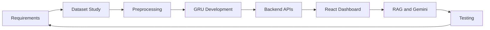

---

## Slide 21 - Why Agile?

Agile is suitable because:

- The model requires repeated experimentation.
- Dataset preprocessing may change during development.
- Forecasting performance must be evaluated continuously.
- Backend and frontend can be developed in parallel.
- Chatbot behavior requires iterative testing.
- User feedback can improve dashboard usability.
- New patient tools and knowledge sources can be added incrementally.

---

## Slide 22 - Use Case Diagram

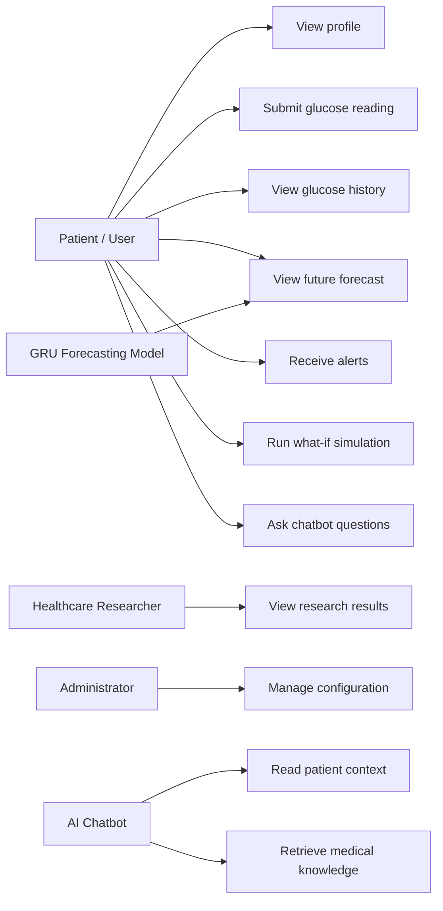

---

## Slide 23 - Detailed Use Cases

### Patient/User

- Log in.
- View dashboard.
- Check current glucose status.
- View historical graph.
- View forecast.
- Read alerts.
- Ask questions.
- Request explanations.
- Run simulations.

### AI System

- Read patient context.
- Retrieve medical knowledge.
- Generate a safe response.
- Access the GRU forecast.
- Return recommendations with safety warnings.

---

## Slide 24 - Activity Diagram

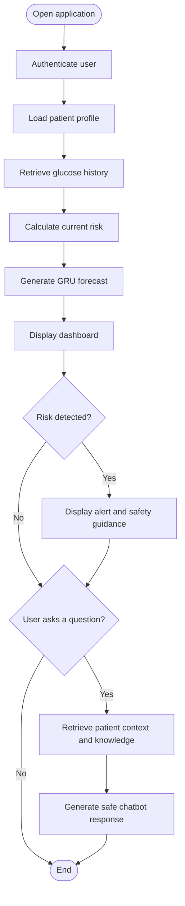

---

## Slide 25 - Sequence Diagram

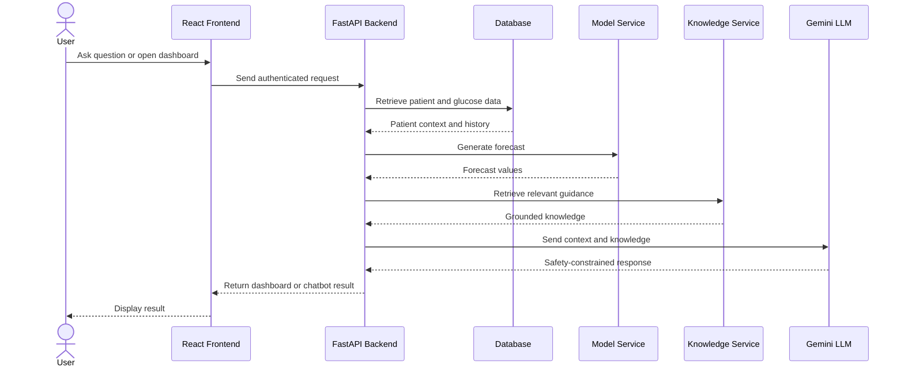

---

## Slide 26 - Functional Requirements

- Store patient information.
- Store glucose readings.
- Validate glucose input values.
- Retrieve historical glucose data.
- Generate GRU forecasts.
- Classify glucose risk.
- Generate alerts.
- Support what-if simulation.
- Provide a chatbot.
- Use patient context in chatbot responses.
- Retrieve curated medical knowledge.
- Display graphs and summaries.

---

## Slide 27 - Non-Functional Requirements

- **Performance:** Forecast requests should respond efficiently.
- **Scalability:** The system should support multiple patients.
- **Usability:** The dashboard should be simple and mobile-friendly.
- **Security:** Patient data must be protected.
- **Reliability:** Invalid readings must be rejected.
- **Maintainability:** Backend, model, and frontend should be modular.
- **Privacy:** API keys must not be stored in source code.
- **Safety:** The system must not provide diagnosis or medication changes.
- **Availability:** Health and readiness endpoints should verify system status.

---

## Slide 28 - Dataset Description

### Dataset name

**T1DiabetesGranada: A Longitudinal Multi-Modal Dataset of Type 1 Diabetes
Mellitus**

### Files

- `Glucose_measurements.csv`
- `Patient_info.csv`
- `Biochemical_parameters.csv`
- `Diagnostics.csv`

### Verified summary

- 736 patients.
- Approximately 22.67 million glucose measurements.
- Data collected approximately from 2018 to 2022.
- Glucose range from 40 to 500 mg/dL.
- Patient demographic information.
- Biochemical laboratory measurements.
- Diagnostic records.

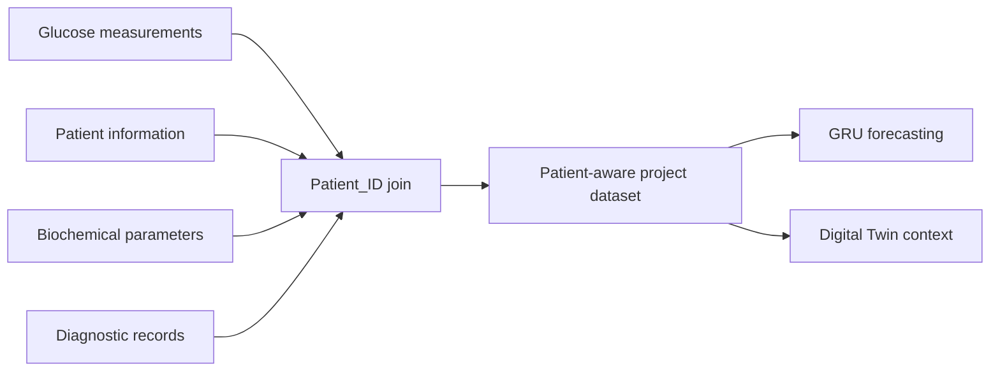

---

## Slide 29 - Data Preparation

### Stage 1 - Data cleaning

- Remove invalid records.
- Validate glucose values.
- Handle missing patient information.
- Parse dates and timestamps.
- Remove duplicates where necessary.

### Stage 2 - Patient joining

- Join glucose records with `Patient_info.csv`.
- Match records using `Patient_ID`.
- Add age and sex features.

### Stage 3 - Sequence creation

- Sort glucose readings chronologically.
- Create sequences of 48 readings.
- Use the next glucose value as the prediction target.

---

## Slide 30 - Feature Scaling and Dataset Splitting

### Model features

```text
glucose
age_years
sex_male
```

### Processing

- Normalize numerical features.
- Encode sex as a numerical feature.
- Preserve time order.
- Split into training, validation, and test sets.
- Avoid using future information during training.

### Model input

```text
48 time steps x 3 features
```

---

## Slide 31 - Proposed Model

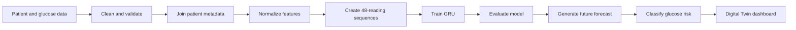

---

## Slide 32 - Internal Architecture

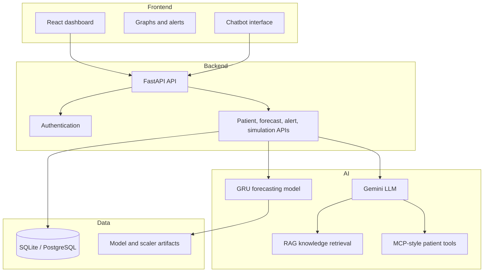

---

## Slide 33 - Modules: Data and Preprocessing

### Module 1 - Data collection

Data sources include glucose measurements, patient information, biochemical
parameters, and diagnostic records.

### Module 2 - Data preprocessing

- Validate glucose values.
- Parse date and time fields.
- Merge patient features.
- Normalize numerical values.
- Create chronological sequences.
- Separate training and testing data.

---

## Slide 34 - Modules: Prediction and Application

### Module 3 - GRU forecasting

Receives 48 previous glucose time steps, uses age and sex, and predicts future
glucose values.

### Module 4 - Risk and alert

Detects low and high glucose risk and generates safety alerts.

### Module 5 - Digital Twin dashboard

Shows patient profile, current glucose, historical trend, forecast, alerts, and
recommendations.

### Module 6 - LLM, RAG, and MCP

Retrieves patient context and medical knowledge and uses Gemini for safe
natural-language responses.

---

## Slide 35 - GRU Algorithm

**Input:** 48 historical glucose readings, patient age, and patient sex.

**Output:** Future glucose forecast.

1. Load and validate patient glucose data.
2. Sort readings chronologically.
3. Create sequences of 48 readings.
4. Normalize input features.
5. Initialize the GRU model.
6. Pass each sequence through the GRU layers.
7. Generate the next glucose prediction.
8. Calculate prediction loss.
9. Update model weights using backpropagation.
10. Repeat for multiple epochs.
11. Evaluate using MAE, RMSE, and R-squared.
12. Generate recursive future predictions.

---

## Slide 36 - Risk Classification Algorithm

```text
Input: Current glucose value

If glucose < 54:
    Level 2 hypoglycemia
Else if glucose is 54-69:
    Level 1 hypoglycemia
Else if glucose is 70-180:
    Target range
Else if glucose is 181-250:
    Level 1 hyperglycemia
Else:
    Level 2 hyperglycemia

Generate alert and safety guidance.
```

This classification indicates a possible glucose risk and is not a diagnosis.

---

## Slide 37 - Results: Model Performance

### GRU evaluation results

- Test sequences: approximately 3.36 million.
- MAE: **6.4427 mg/dL**.
- RMSE: **11.5862 mg/dL**.
- R-squared: **0.97575**.

MAE represents average absolute prediction error. RMSE gives greater weight to
larger errors. R-squared indicates how well the model explains glucose
variation in the test data.

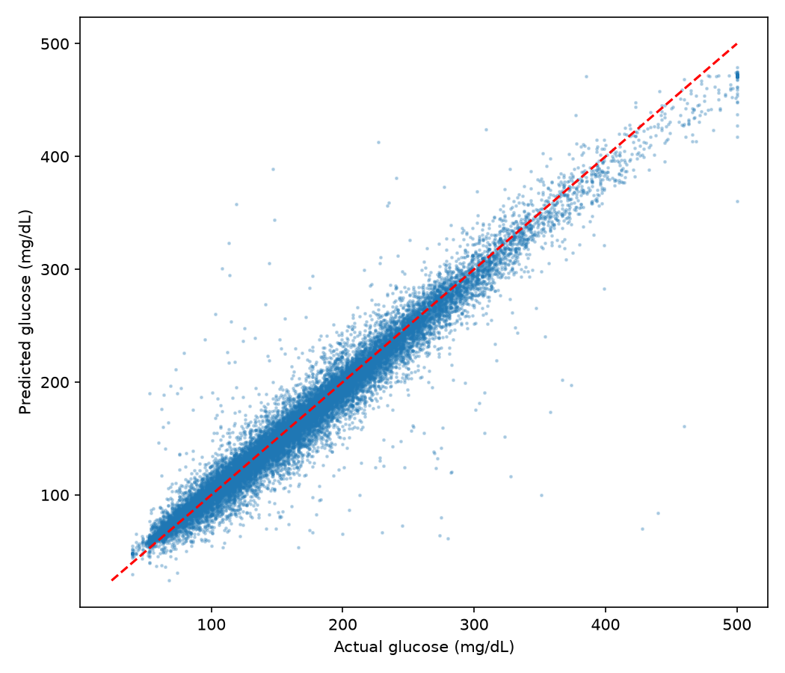

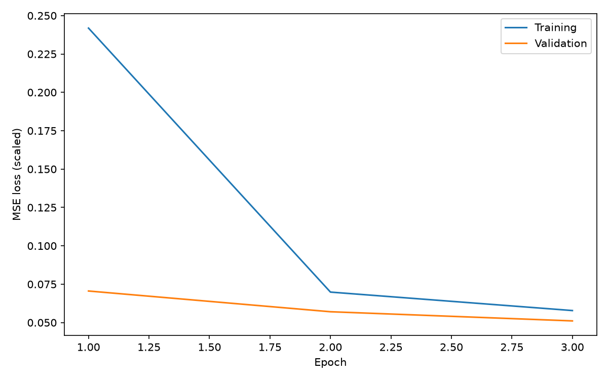

---

## Slide 38 - Results: Forecast Example

Show:

- Last 12 hours of historical glucose.
- Next 3 hours of predicted glucose.
- Actual and predicted values using different colors.
- Forecast timestamp.
- Risk classification.

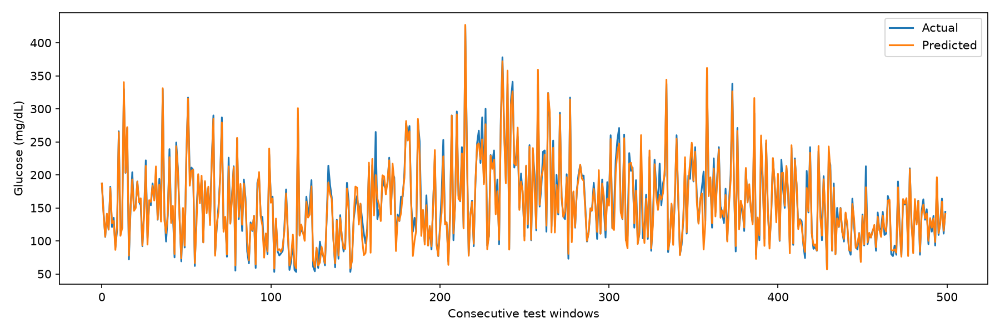

---

## Slide 39 - Results: Dashboard Interface

The dashboard displays:

- Patient profile.
- Current glucose value.
- Current risk status.
- Historical glucose graph.
- Future forecast.
- Alerts.
- Recommendations.
- What-if simulation.
- Chatbot.

**Suggested image:** Add a screenshot from the running dashboard at
`http://127.0.0.1:8000/app`.

---

## Slide 40 - Results: Low Glucose Alert

```text
Alert: Possible low glucose detected.
Current reading: 52 mg/dL.
Risk: Level 2 hypoglycemia.

Follow the patient's clinician-approved hypoglycemia plan. If severe symptoms,
confusion, unconsciousness, or inability to respond occur, seek urgent medical
assistance.
```

**Suggested image:** Screenshot of the low-glucose alert banner.

---

## Slide 41 - Results: High Glucose Alert

```text
Alert: Possible high glucose detected.
Current reading: 285 mg/dL.
Risk: Level 2 hyperglycemia.

Recheck according to the care plan and contact a healthcare professional if
the value remains high or symptoms occur. Follow clinician-approved sick-day
and ketone-testing instructions where applicable.
```

**Suggested image:** Screenshot of the high-glucose alert.

---

## Slide 42 - Results: Forecast Graph

The forecast graph represents:

- Historical glucose measurements up to the current time.
- Predicted glucose values after the current time.
- Forecast direction.
- Possible risk zones.
- Prediction limitations.

The historical section contains measured glucose values. The future section
contains model predictions and is not a confirmed CGM measurement.

---

## Slide 43 - Results: Patient Digital Twin

The Digital Twin combines:

- Patient demographic information.
- Current glucose reading.
- Recent glucose history.
- Future forecast.
- Risk classification.
- Alerts.
- Recommendations.
- What-if results.
- Chatbot context.

**Suggested image:** Digital Twin state card from the application.

---

## Slide 44 - Results: What-If Simulation

The user can enter a hypothetical glucose change.

**Example:** Current value 160 mg/dL; hypothetical change +30 mg/dL.

The system compares a baseline forecast with a hypothetical forecast.

**Important limitation:** What-if simulation is a mathematical model
comparison. It does not measure real glucose, prove causality, or replace
medical advice.

**Suggested image:** Screenshot of simulation controls and output.

---

## Slide 45 - Results: Chatbot, RAG, and MCP

### Chatbot capabilities

- Reads patient profile.
- Reads latest glucose value.
- Reads recent glucose history.
- Reads alerts.
- Reads GRU forecast.
- Retrieves relevant medical knowledge.
- Provides a natural-language explanation.

### Safety restrictions

- No diagnosis.
- No insulin prescription.
- No medication changes.
- No guarantee of normalization.
- Emergency warnings when appropriate.

**Suggested image:** Screenshot of chatbot conversation.

---

## Slide 46 - Timeline Chart

| Phase | Work |
|---|---|
| 1 | Literature review and requirement analysis |
| 2 | Dataset understanding |
| 3 | Data preprocessing |
| 4 | GRU model training |
| 5 | Model evaluation |
| 6 | FastAPI backend development |
| 7 | React dashboard development |
| 8 | Alert and simulation implementation |
| 9 | RAG and Gemini chatbot integration |
| 10 | Testing and documentation |

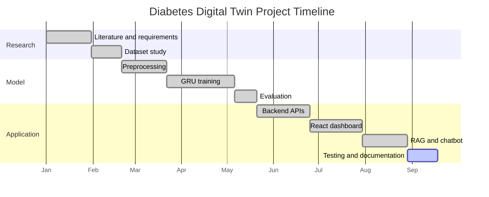

---

## Slide 47 - Conclusion and Future Work

### Conclusion

This project developed an AI-driven Diabetes Digital Twin for personalized
glucose monitoring and forecasting. The patient-aware GRU model uses historical
glucose readings, age, and sex to forecast future glucose values.

The application provides glucose history visualization, future glucose
forecasting, risk classification, safety alerts, what-if simulation,
RAG-based knowledge retrieval, MCP-style patient tools, and Gemini-based
chatbot interaction.

The system is a research and decision-support prototype, not a replacement for
clinical diagnosis or medical treatment.

### Future work

- Add insulin, meal, exercise, and sleep data.
- Add real-time CGM device integration.
- Add forecast confidence intervals.
- Improve RAG using reviewed clinical documents.
- Implement true Gemini function/tool calling.
- Add mobile notifications.
- Perform external validation on other T1D datasets.
- Conduct clinical and regulatory evaluation.
- Improve authentication, auditing, and privacy controls.

---

## Slide 48 - References I

1. Rodriguez-Leon, C., et al. “T1DiabetesGranada: A Longitudinal Multi-Modal
   Dataset of Type 1 Diabetes Mellitus.” *Scientific Data*, 2023.
2. Cho, K., et al. “Learning Phrase Representations Using RNN Encoder-Decoder
   for Statistical Machine Translation.” 2014.
3. Chung, J., et al. “Empirical Evaluation of Gated Recurrent Neural Networks
   on Sequence Modeling.” 2014.
4. American Diabetes Association. *Standards of Care in Diabetes.*
5. World Health Organization. *Diabetes: Key Facts.*

---

## Slide 49 - References II

6. Google AI for Developers. *Gemini API Documentation.*
7. FastAPI Documentation.
8. React Documentation.
9. PostgreSQL Documentation.
10. Scikit-learn Documentation.
11. PyTorch Documentation.
12. T1DiabetesGranada dataset documentation and accompanying research paper.

---

## Project-specific viva answers

### What parameters are used to forecast glucose?

The GRU uses the previous 48 glucose readings, approximately representing 12
hours when readings are 15 minutes apart. It also uses patient age and encoded
sex. The feature order is:

```text
[glucose, age_years, sex_male]
```

The model forecasts approximately 12 future values at 15-minute intervals,
representing about three hours.

### Does this model diagnose diabetes?

No. The dataset contains patients with existing diabetes, particularly type 1
diabetes. The model forecasts future glucose and identifies possible glucose
risk. It does not diagnose diabetes or predict whether a non-diabetic person
will develop type 1 diabetes.

### What is the role of RAG?

RAG retrieves curated medical safety information relevant to the user's
question. It grounds the chatbot response instead of relying only on the
language model's general knowledge.

### What is the role of MCP-style tools?

The tools provide structured access to patient profile, glucose history, risk
status, forecast, simulation, recommendations, and medical knowledge.

### What is the role of Gemini?

Gemini converts the retrieved patient context and medical guidance into a
natural-language explanation. Safety instructions prevent diagnosis,
prescription, and unsupported treatment claims.

### Is this ready for hospital use?

No. It is currently a local research prototype. Hospital deployment would
require clinical validation, privacy review, security assessment, real CGM
integration, monitoring, regulatory review, and professional approval.

---

## Project assets for presentation images

Existing project plots can be reused:

- [`plots/actual_vs_predicted.png`](plots/actual_vs_predicted.png)
- [`plots/glucose_trajectory.png`](plots/glucose_trajectory.png)
- [`plots/prediction_error_distribution.png`](plots/prediction_error_distribution.png)
- [`plots/training_validation_loss.png`](plots/training_validation_loss.png)

For dashboard, alerts, chatbot, and simulation slides, capture screenshots
from the running application at `http://127.0.0.1:8000/app`.
